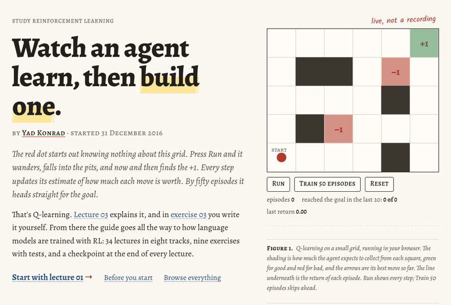

# rl.yad.codes

The site for [Study-Reinforcement-Learning](https://github.com/0bserver07/Study-Reinforcement-Learning), live at **https://rl.yad.codes**.



The lectures, exercises, and notes are plain markdown in the study repo. This repo pulls the study repo in as the `study/` submodule and builds every page from it. What was written for the site lives here: the home page, where a Q-learning agent learns a small grid in your browser; the three slot machines in the [/why/](https://rl.yad.codes/why/) essay; the track map; and the study planner.

## Run it

Needs Node 22.12 or newer.

```bash
git clone --recurse-submodules https://github.com/0bserver07/rl-study-site
cd rl-study-site
npm ci
npm run dev      # reads study/, then serves http://localhost:4321
npm run build    # the static site, in dist/
```

Every push to `master` builds the site and deploys it to GitHub Pages.

## Where things are

| Path | What it is |
|---|---|
| `study/` | the study repo, pinned to the commit the site is built from |
| `scripts/sync-study.mjs` | turns the study repo's markdown into the site's pages, before every `dev` and `build` |
| `src/pages/index.astro` | the home page |
| `src/components/roadmap/` | the agent (`GridLearner`), the slot machines (`Bandit`), the track map, the study planner, the signup |
| `src/essays/why-rl.mdx` | the /why/ essay |
| `site-pages/about.md` | the About page |

[STUDY-SITE.md](STUDY-SITE.md) has the details, including how to cut a release. [RELEASES.md](RELEASES.md) lists what changed in each version.

## Found a mistake?

Every lecture is still marked unreviewed. If a lecture, exercise, or note is wrong, open an issue or a pull request on the [study repo](https://github.com/0bserver07/Study-Reinforcement-Learning). Every lecture page on the site links to its source file there. If something on the site itself is broken (a page, a demo, a link), open an issue here.

## License

Code: MIT, see [LICENSE](LICENSE). The site started from [Mycelium](https://github.com/0bserver07/mycelium-theme), an Astro theme, and keeps its license. The text of the lectures and notes comes from the study repo and is licensed [CC BY-NC-ND 4.0](https://github.com/0bserver07/Study-Reinforcement-Learning/blob/master/license.md).
